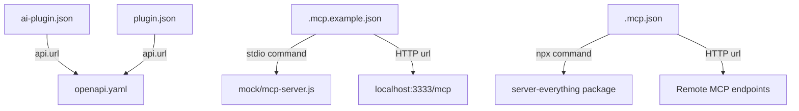

<!-- PAGE_ID: acquaman-plugin_01_overview -->

📚 Relevant source files

The following files were used as context for generating this wiki page:

- [README.md:1-23](https://github.com/port-gh-app-dev/acquaman-plugin/blob/7b88b3f075d9942173848e604a87dcbfbc62ba57/README.md#L1-L23)
- [ai-plugin.json:1-18](https://github.com/port-gh-app-dev/acquaman-plugin/blob/7b88b3f075d9942173848e604a87dcbfbc62ba57/.well-known/ai-plugin.json#L1-L18)
- [plugin.json:1-18](https://github.com/port-gh-app-dev/acquaman-plugin/blob/7b88b3f075d9942173848e604a87dcbfbc62ba57/.codex-plugin/plugin.json#L1-L18)
- [.mcp.json:1-29](https://github.com/port-gh-app-dev/acquaman-plugin/blob/7b88b3f075d9942173848e604a87dcbfbc62ba57/.mcp.json#L1-L29)
- [.mcp.example.json:1-16](https://github.com/port-gh-app-dev/acquaman-plugin/blob/7b88b3f075d9942173848e604a87dcbfbc62ba57/.mcp.example.json#L1-L16)
- [openapi.yaml:1-43](https://github.com/port-gh-app-dev/acquaman-plugin/blob/7b88b3f075d9942173848e604a87dcbfbc62ba57/openapi.yaml#L1-L43)
- [mcp-server.js:1-5](https://github.com/port-gh-app-dev/acquaman-plugin/blob/7b88b3f075d9942173848e604a87dcbfbc62ba57/mock/mcp-server.js#L1-L5)
- [ci_workflow_1_xz25.yml:1-13](https://github.com/port-gh-app-dev/acquaman-plugin/blob/7b88b3f075d9942173848e604a87dcbfbc62ba57/.github/workflows/ci_workflow_1_xz25.yml#L1-L13)
- [ci_workflow_2_pnwt.yml:1-13](https://github.com/port-gh-app-dev/acquaman-plugin/blob/7b88b3f075d9942173848e604a87dcbfbc62ba57/.github/workflows/ci_workflow_2_pnwt.yml#L1-L13)

# Overview

> **Related Pages**: [[Plugin Manifests|02_plugin-manifests.md]], [[API Contract|03_api-contract.md]], [[MCP Configuration and Mock Server|04_mcp-configuration.md]], [[CI and Known Issues|05_ci-and-known-issues.md]]

---

<!-- BEGIN:AUTOGEN acquaman-plugin_01_overview_introduction -->
## Introduction

Acquaman Plugin is a scaffold that supports an OpenAI plugin-style integration and a local Codex MCP (Model Context Protocol) configuration ([README.md:1-3](https://github.com/port-gh-app-dev/acquaman-plugin/blob/7b88b3f075d9942173848e604a87dcbfbc62ba57/README.md#L1-L3)). It contains no real application logic: the README states that the scaffold is intentionally minimal and mock-oriented ([README.md:22](https://github.com/port-gh-app-dev/acquaman-plugin/blob/7b88b3f075d9942173848e604a87dcbfbc62ba57/README.md#L22)).

The plugin is described to models as a tool for inspecting Acquaman plugin status and fetching mock plugin capabilities ([ai-plugin.json:6](https://github.com/port-gh-app-dev/acquaman-plugin/blob/7b88b3f075d9942173848e604a87dcbfbc62ba57/.well-known/ai-plugin.json#L6)). Its only declared API surface is two read-only endpoints, `/health` and `/capabilities` ([openapi.yaml:9-43](https://github.com/port-gh-app-dev/acquaman-plugin/blob/7b88b3f075d9942173848e604a87dcbfbc62ba57/openapi.yaml#L9-L43)).

Sources: [README.md:1-23](https://github.com/port-gh-app-dev/acquaman-plugin/blob/7b88b3f075d9942173848e604a87dcbfbc62ba57/README.md#L1-L23), [ai-plugin.json:1-18](https://github.com/port-gh-app-dev/acquaman-plugin/blob/7b88b3f075d9942173848e604a87dcbfbc62ba57/.well-known/ai-plugin.json#L1-L18), [openapi.yaml:1-43](https://github.com/port-gh-app-dev/acquaman-plugin/blob/7b88b3f075d9942173848e604a87dcbfbc62ba57/openapi.yaml#L1-L43)
<!-- END:AUTOGEN acquaman-plugin_01_overview_introduction -->

---

<!-- BEGIN:AUTOGEN acquaman-plugin_01_overview_repository-layout -->
## Repository Layout

The repository consists of nine tracked files. The README lists five of them as "Included Files" ([README.md:5-11](https://github.com/port-gh-app-dev/acquaman-plugin/blob/7b88b3f075d9942173848e604a87dcbfbc62ba57/README.md#L5-L11)); the Codex manifest and the two CI workflows are present in the repository but are not mentioned in the README.

| Path | Role |
|------|------|
| `README.md` | Human-readable description and quick start ([README.md:1-23](https://github.com/port-gh-app-dev/acquaman-plugin/blob/7b88b3f075d9942173848e604a87dcbfbc62ba57/README.md#L1-L23)) |
| `.well-known/ai-plugin.json` | OpenAI plugin-style manifest ([ai-plugin.json:1-18](https://github.com/port-gh-app-dev/acquaman-plugin/blob/7b88b3f075d9942173848e604a87dcbfbc62ba57/.well-known/ai-plugin.json#L1-L18)) |
| `.codex-plugin/plugin.json` | Codex plugin manifest ([plugin.json:1-18](https://github.com/port-gh-app-dev/acquaman-plugin/blob/7b88b3f075d9942173848e604a87dcbfbc62ba57/.codex-plugin/plugin.json#L1-L18)) |
| `openapi.yaml` | Mock OpenAPI 3.0.3 contract referenced by both manifests ([openapi.yaml:1-8](https://github.com/port-gh-app-dev/acquaman-plugin/blob/7b88b3f075d9942173848e604a87dcbfbc62ba57/openapi.yaml#L1-L8)) |
| `.mcp.json` | Local default MCP server configuration ([.mcp.json:1-29](https://github.com/port-gh-app-dev/acquaman-plugin/blob/7b88b3f075d9942173848e604a87dcbfbc62ba57/.mcp.json#L1-L29)) |
| `.mcp.example.json` | Example HTTP and stdio MCP configurations ([.mcp.example.json:1-16](https://github.com/port-gh-app-dev/acquaman-plugin/blob/7b88b3f075d9942173848e604a87dcbfbc62ba57/.mcp.example.json#L1-L16)) |
| `mock/mcp-server.js` | Placeholder stdio MCP server script ([mcp-server.js:1-5](https://github.com/port-gh-app-dev/acquaman-plugin/blob/7b88b3f075d9942173848e604a87dcbfbc62ba57/mock/mcp-server.js#L1-L5)) |
| `.github/workflows/ci_workflow_1_xz25.yml` | Placeholder CI workflow ([ci_workflow_1_xz25.yml:1-13](https://github.com/port-gh-app-dev/acquaman-plugin/blob/7b88b3f075d9942173848e604a87dcbfbc62ba57/.github/workflows/ci_workflow_1_xz25.yml#L1-L13)) |
| `.github/workflows/ci_workflow_2_pnwt.yml` | Second, near-identical placeholder CI workflow ([ci_workflow_2_pnwt.yml:1-13](https://github.com/port-gh-app-dev/acquaman-plugin/blob/7b88b3f075d9942173848e604a87dcbfbc62ba57/.github/workflows/ci_workflow_2_pnwt.yml#L1-L13)) |

Sources: [ai-plugin.json:10-14](https://github.com/port-gh-app-dev/acquaman-plugin/blob/7b88b3f075d9942173848e604a87dcbfbc62ba57/.well-known/ai-plugin.json#L10-L14), [plugin.json:10-14](https://github.com/port-gh-app-dev/acquaman-plugin/blob/7b88b3f075d9942173848e604a87dcbfbc62ba57/.codex-plugin/plugin.json#L10-L14), [.mcp.example.json:3-14](https://github.com/port-gh-app-dev/acquaman-plugin/blob/7b88b3f075d9942173848e604a87dcbfbc62ba57/.mcp.example.json#L3-L14), [.mcp.json:2-27](https://github.com/port-gh-app-dev/acquaman-plugin/blob/7b88b3f075d9942173848e604a87dcbfbc62ba57/.mcp.json#L2-L27)
<!-- END:AUTOGEN acquaman-plugin_01_overview_repository-layout -->

---

<!-- BEGIN:AUTOGEN acquaman-plugin_01_overview_quick-start -->
## Quick Start

The README gives four steps ([README.md:13-18](https://github.com/port-gh-app-dev/acquaman-plugin/blob/7b88b3f075d9942173848e604a87dcbfbc62ba57/README.md#L13-L18)):

1. Serve the repository files from `http://localhost:3333`, or update the URLs in `ai-plugin.json`.
2. Customize `openapi.yaml` endpoints for the real plugin API.
3. Replace placeholder values in `.mcp.example.json` and copy it to `.mcp.json` as needed.
4. Implement a real MCP server in `mock/mcp-server.js`, or point `.mcp.json` to an actual server command.

The repository does not include a script or server that serves files on port 3333; the README leaves that to the user. The manifests and the example MCP configuration all assume `localhost:3333` ([ai-plugin.json:12](https://github.com/port-gh-app-dev/acquaman-plugin/blob/7b88b3f075d9942173848e604a87dcbfbc62ba57/.well-known/ai-plugin.json#L12), [openapi.yaml:6-7](https://github.com/port-gh-app-dev/acquaman-plugin/blob/7b88b3f075d9942173848e604a87dcbfbc62ba57/openapi.yaml#L6-L7), [.mcp.example.json:4](https://github.com/port-gh-app-dev/acquaman-plugin/blob/7b88b3f075d9942173848e604a87dcbfbc62ba57/.mcp.example.json#L4)).

The README also notes that `contact_email`, `legal_info_url`, API URLs, and auth settings should be updated for production use ([README.md:23](https://github.com/port-gh-app-dev/acquaman-plugin/blob/7b88b3f075d9942173848e604a87dcbfbc62ba57/README.md#L23)).

Sources: [README.md:13-23](https://github.com/port-gh-app-dev/acquaman-plugin/blob/7b88b3f075d9942173848e604a87dcbfbc62ba57/README.md#L13-L23)
<!-- END:AUTOGEN acquaman-plugin_01_overview_quick-start -->

---
