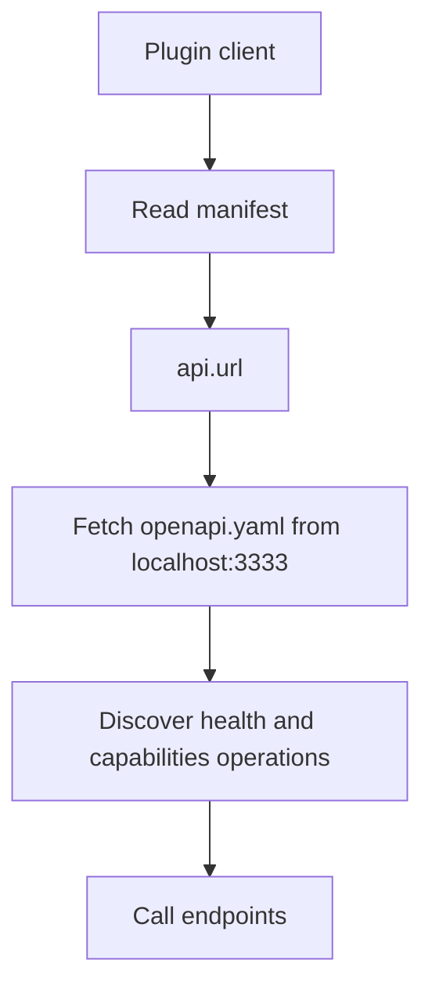

<!-- PAGE_ID: acquaman-plugin_02_plugin-manifests -->

📚 Relevant source files

The following files were used as context for generating this wiki page:

- [ai-plugin.json:1-18](https://github.com/port-gh-app-dev/acquaman-plugin/blob/7b88b3f075d9942173848e604a87dcbfbc62ba57/.well-known/ai-plugin.json#L1-L18)
- [plugin.json:1-18](https://github.com/port-gh-app-dev/acquaman-plugin/blob/7b88b3f075d9942173848e604a87dcbfbc62ba57/.codex-plugin/plugin.json#L1-L18)
- [openapi.yaml:1-8](https://github.com/port-gh-app-dev/acquaman-plugin/blob/7b88b3f075d9942173848e604a87dcbfbc62ba57/openapi.yaml#L1-L8)

# Plugin Manifests

> **Related Pages**: [[Overview|01_overview.md]], [[API Contract|03_api-contract.md]]

---

<!-- BEGIN:AUTOGEN acquaman-plugin_02_plugin-manifests_ai-plugin -->
## OpenAI Plugin Manifest

`.well-known/ai-plugin.json` follows the OpenAI plugin manifest convention with `schema_version` set to `v1` ([ai-plugin.json:2](https://github.com/port-gh-app-dev/acquaman-plugin/blob/7b88b3f075d9942173848e604a87dcbfbc62ba57/.well-known/ai-plugin.json#L2)).

| Field | Value | Purpose |
|-------|-------|---------|
| `name_for_human` | `Acquaman Plugin` | Display name ([ai-plugin.json:3](https://github.com/port-gh-app-dev/acquaman-plugin/blob/7b88b3f075d9942173848e604a87dcbfbc62ba57/.well-known/ai-plugin.json#L3)) |
| `name_for_model` | `acquaman_plugin` | Identifier used by the model ([ai-plugin.json:4](https://github.com/port-gh-app-dev/acquaman-plugin/blob/7b88b3f075d9942173848e604a87dcbfbc62ba57/.well-known/ai-plugin.json#L4)) |
| `description_for_human` | Example OpenAI Codex-ready plugin scaffold for Acquaman. | User-facing text ([ai-plugin.json:5](https://github.com/port-gh-app-dev/acquaman-plugin/blob/7b88b3f075d9942173848e604a87dcbfbc62ba57/.well-known/ai-plugin.json#L5)) |
| `description_for_model` | Inspect plugin status and fetch mock capabilities | Tells the model when to use the plugin ([ai-plugin.json:6](https://github.com/port-gh-app-dev/acquaman-plugin/blob/7b88b3f075d9942173848e604a87dcbfbc62ba57/.well-known/ai-plugin.json#L6)) |
| `auth.type` | `none` | No authentication ([ai-plugin.json:7-9](https://github.com/port-gh-app-dev/acquaman-plugin/blob/7b88b3f075d9942173848e604a87dcbfbc62ba57/.well-known/ai-plugin.json#L7-L9)) |
| `api.type` / `api.url` | `openapi` / `http://localhost:3333/openapi.yaml` | Location of the API contract ([ai-plugin.json:10-14](https://github.com/port-gh-app-dev/acquaman-plugin/blob/7b88b3f075d9942173848e604a87dcbfbc62ba57/.well-known/ai-plugin.json#L10-L14)) |
| `api.is_user_authenticated` | `false` | ([ai-plugin.json:13](https://github.com/port-gh-app-dev/acquaman-plugin/blob/7b88b3f075d9942173848e604a87dcbfbc62ba57/.well-known/ai-plugin.json#L13)) |
| `logo_url` | `http://localhost:3333/logo.png` | ([ai-plugin.json:15](https://github.com/port-gh-app-dev/acquaman-plugin/blob/7b88b3f075d9942173848e604a87dcbfbc62ba57/.well-known/ai-plugin.json#L15)) |
| `contact_email` | `support@example.com` | Placeholder ([ai-plugin.json:16](https://github.com/port-gh-app-dev/acquaman-plugin/blob/7b88b3f075d9942173848e604a87dcbfbc62ba57/.well-known/ai-plugin.json#L16)) |
| `legal_info_url` | `http://localhost:3333/legal` | ([ai-plugin.json:17](https://github.com/port-gh-app-dev/acquaman-plugin/blob/7b88b3f075d9942173848e604a87dcbfbc62ba57/.well-known/ai-plugin.json#L17)) |

Sources: [ai-plugin.json:1-18](https://github.com/port-gh-app-dev/acquaman-plugin/blob/7b88b3f075d9942173848e604a87dcbfbc62ba57/.well-known/ai-plugin.json#L1-L18)
<!-- END:AUTOGEN acquaman-plugin_02_plugin-manifests_ai-plugin -->

---

<!-- BEGIN:AUTOGEN acquaman-plugin_02_plugin-manifests_codex-plugin -->
## Codex Plugin Manifest

`.codex-plugin/plugin.json` declares the plugin as `acquaman-dc-plugin`, version `1.0.0`, described as an "Example OpenAI Codex-ready plugin scaffold for Acquaman." ([plugin.json:3-5](https://github.com/port-gh-app-dev/acquaman-plugin/blob/7b88b3f075d9942173848e604a87dcbfbc62ba57/.codex-plugin/plugin.json#L3-L5)). It also sets `skills` to `./skills/` ([plugin.json:6](https://github.com/port-gh-app-dev/acquaman-plugin/blob/7b88b3f075d9942173848e604a87dcbfbc62ba57/.codex-plugin/plugin.json#L6)), but no `skills/` directory exists in the repository.

The `auth`, `api`, `logo_url`, `contact_email`, and `legal_info_url` blocks are the same as in the OpenAI manifest ([plugin.json:7-17](https://github.com/port-gh-app-dev/acquaman-plugin/blob/7b88b3f075d9942173848e604a87dcbfbc62ba57/.codex-plugin/plugin.json#L7-L17)).

> **Warning:** As committed, this file is not valid JSON. Line 6 (`"skills": "./skills/"`) is not followed by a comma before the `"auth"` key on line 7 ([plugin.json:6-7](https://github.com/port-gh-app-dev/acquaman-plugin/blob/7b88b3f075d9942173848e604a87dcbfbc62ba57/.codex-plugin/plugin.json#L6-L7)). A strict JSON parser will reject the file.

Sources: [plugin.json:1-18](https://github.com/port-gh-app-dev/acquaman-plugin/blob/7b88b3f075d9942173848e604a87dcbfbc62ba57/.codex-plugin/plugin.json#L1-L18)
<!-- END:AUTOGEN acquaman-plugin_02_plugin-manifests_codex-plugin -->

---

<!-- BEGIN:AUTOGEN acquaman-plugin_02_plugin-manifests_comparison -->
## Manifest Comparison and Discovery Flow

Both manifests point to the same OpenAPI file, so the API contract is defined once ([ai-plugin.json:12](https://github.com/port-gh-app-dev/acquaman-plugin/blob/7b88b3f075d9942173848e604a87dcbfbc62ba57/.well-known/ai-plugin.json#L12), [plugin.json:12](https://github.com/port-gh-app-dev/acquaman-plugin/blob/7b88b3f075d9942173848e604a87dcbfbc62ba57/.codex-plugin/plugin.json#L12)). The OpenAPI document declares `http://localhost:3333` as its server ([openapi.yaml:6-7](https://github.com/port-gh-app-dev/acquaman-plugin/blob/7b88b3f075d9942173848e604a87dcbfbc62ba57/openapi.yaml#L6-L7)).

| Aspect | `ai-plugin.json` | `plugin.json` |
|--------|------------------|---------------|
| Name | `acquaman_plugin` ([ai-plugin.json:4](https://github.com/port-gh-app-dev/acquaman-plugin/blob/7b88b3f075d9942173848e604a87dcbfbc62ba57/.well-known/ai-plugin.json#L4)) | `acquaman-dc-plugin` ([plugin.json:3](https://github.com/port-gh-app-dev/acquaman-plugin/blob/7b88b3f075d9942173848e604a87dcbfbc62ba57/.codex-plugin/plugin.json#L3)) |
| Version | none | `1.0.0` ([plugin.json:4](https://github.com/port-gh-app-dev/acquaman-plugin/blob/7b88b3f075d9942173848e604a87dcbfbc62ba57/.codex-plugin/plugin.json#L4)) |
| Model-facing description | Present ([ai-plugin.json:6](https://github.com/port-gh-app-dev/acquaman-plugin/blob/7b88b3f075d9942173848e604a87dcbfbc62ba57/.well-known/ai-plugin.json#L6)) | Absent |
| Skills path | none | `./skills/` ([plugin.json:6](https://github.com/port-gh-app-dev/acquaman-plugin/blob/7b88b3f075d9942173848e604a87dcbfbc62ba57/.codex-plugin/plugin.json#L6)) |

Sources: [ai-plugin.json:10-14](https://github.com/port-gh-app-dev/acquaman-plugin/blob/7b88b3f075d9942173848e604a87dcbfbc62ba57/.well-known/ai-plugin.json#L10-L14), [plugin.json:10-14](https://github.com/port-gh-app-dev/acquaman-plugin/blob/7b88b3f075d9942173848e604a87dcbfbc62ba57/.codex-plugin/plugin.json#L10-L14), [openapi.yaml:6-7](https://github.com/port-gh-app-dev/acquaman-plugin/blob/7b88b3f075d9942173848e604a87dcbfbc62ba57/openapi.yaml#L6-L7)
<!-- END:AUTOGEN acquaman-plugin_02_plugin-manifests_comparison -->

---
