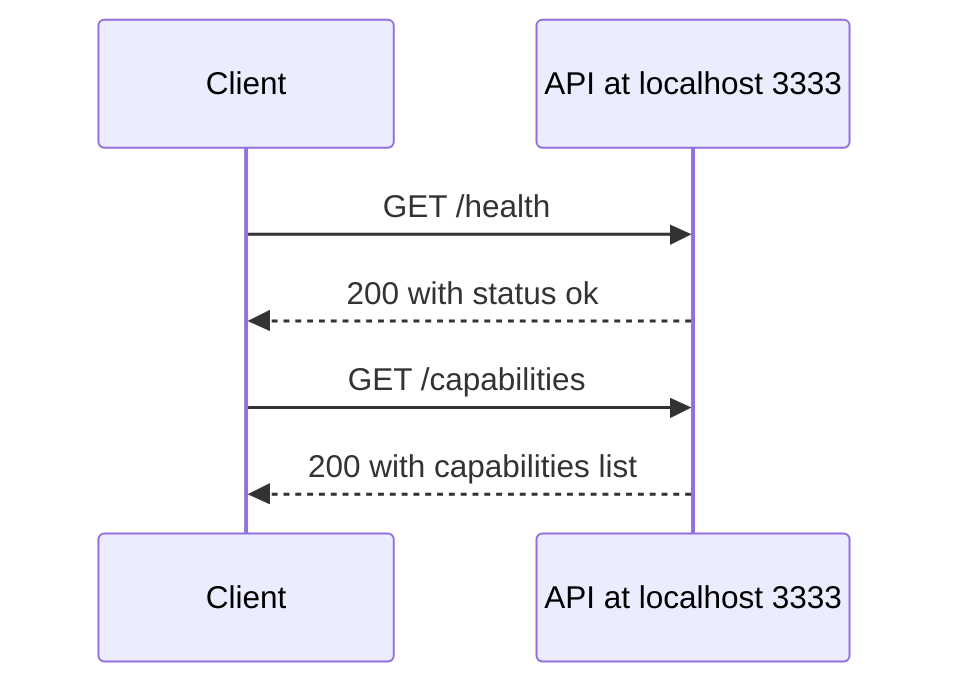

<!-- PAGE_ID: acquaman-plugin_03_api-contract -->
<details>
<summary>📚 Relevant source files</summary>

The following files were used as context for generating this wiki page:

- [openapi.yaml:1-43](https://github.com/port-gh-app-dev/acquaman-plugin/blob/7b88b3f075d9942173848e604a87dcbfbc62ba57/openapi.yaml#L1-L43)

</details>

# API Contract

> **Related Pages**: [[Plugin Manifests|02_plugin-manifests.md]]

---

<!-- BEGIN:AUTOGEN acquaman-plugin_03_api-contract_overview -->
## Specification Overview

`openapi.yaml` is an OpenAPI 3.0.3 document titled "Acquaman Plugin API", version `0.1.0`, described as a mock API contract for an OpenAI Codex plugin scaffold ([openapi.yaml:1-5](https://github.com/port-gh-app-dev/acquaman-plugin/blob/7b88b3f075d9942173848e604a87dcbfbc62ba57/openapi.yaml#L1-L5)). It declares a single server, `http://localhost:3333` ([openapi.yaml:6-7](https://github.com/port-gh-app-dev/acquaman-plugin/blob/7b88b3f075d9942173848e604a87dcbfbc62ba57/openapi.yaml#L6-L7)).

The file defines only paths; it has no `components`, security schemes, or request bodies ([openapi.yaml:8-43](https://github.com/port-gh-app-dev/acquaman-plugin/blob/7b88b3f075d9942173848e604a87dcbfbc62ba57/openapi.yaml#L8-L43)). The repository contains no implementation of these endpoints.

Sources: [openapi.yaml:1-8](https://github.com/port-gh-app-dev/acquaman-plugin/blob/7b88b3f075d9942173848e604a87dcbfbc62ba57/openapi.yaml#L1-L8)
<!-- END:AUTOGEN acquaman-plugin_03_api-contract_overview -->

---

<!-- BEGIN:AUTOGEN acquaman-plugin_03_api-contract_endpoints -->
## Endpoints

| Method | Path | operationId | Summary |
|--------|------|-------------|---------|
| GET | `/health` | `getHealth` | Health check endpoint ([openapi.yaml:9-13](https://github.com/port-gh-app-dev/acquaman-plugin/blob/7b88b3f075d9942173848e604a87dcbfbc62ba57/openapi.yaml#L9-L13)) |
| GET | `/capabilities` | `listCapabilities` | List plugin capabilities ([openapi.yaml:24-28](https://github.com/port-gh-app-dev/acquaman-plugin/blob/7b88b3f075d9942173848e604a87dcbfbc62ba57/openapi.yaml#L24-L28)) |



Sources: [openapi.yaml:9-43](https://github.com/port-gh-app-dev/acquaman-plugin/blob/7b88b3f075d9942173848e604a87dcbfbc62ba57/openapi.yaml#L9-L43)
<!-- END:AUTOGEN acquaman-plugin_03_api-contract_endpoints -->

---

<!-- BEGIN:AUTOGEN acquaman-plugin_03_api-contract_endpoints_health -->
### GET /health

The `getHealth` operation returns `200` with the description "API is healthy" ([openapi.yaml:11-15](https://github.com/port-gh-app-dev/acquaman-plugin/blob/7b88b3f075d9942173848e604a87dcbfbc62ba57/openapi.yaml#L11-L15)). The response is `application/json`: an object with one string property, `status`, whose example is `ok` ([openapi.yaml:16-23](https://github.com/port-gh-app-dev/acquaman-plugin/blob/7b88b3f075d9942173848e604a87dcbfbc62ba57/openapi.yaml#L16-L23)).

```yaml
schema:
  type: object
  properties:
    status:
      type: string
      example: ok
```

Sources: [openapi.yaml:9-23](https://github.com/port-gh-app-dev/acquaman-plugin/blob/7b88b3f075d9942173848e604a87dcbfbc62ba57/openapi.yaml#L9-L23)
<!-- END:AUTOGEN acquaman-plugin_03_api-contract_endpoints_health -->

---

<!-- BEGIN:AUTOGEN acquaman-plugin_03_api-contract_endpoints_capabilities -->
### GET /capabilities

The `listCapabilities` operation returns `200` with the description "Plugin capability list" ([openapi.yaml:29-30](https://github.com/port-gh-app-dev/acquaman-plugin/blob/7b88b3f075d9942173848e604a87dcbfbc62ba57/openapi.yaml#L29-L30)). The `application/json` response is an object with a `capabilities` property, an array of strings ([openapi.yaml:31-39](https://github.com/port-gh-app-dev/acquaman-plugin/blob/7b88b3f075d9942173848e604a87dcbfbc62ba57/openapi.yaml#L31-L39)). The example value lists `health` and `capabilities` ([openapi.yaml:40-43](https://github.com/port-gh-app-dev/acquaman-plugin/blob/7b88b3f075d9942173848e604a87dcbfbc62ba57/openapi.yaml#L40-L43)).

```json
{ "capabilities": ["health", "capabilities"] }
```

Sources: [openapi.yaml:24-43](https://github.com/port-gh-app-dev/acquaman-plugin/blob/7b88b3f075d9942173848e604a87dcbfbc62ba57/openapi.yaml#L24-L43)
<!-- END:AUTOGEN acquaman-plugin_03_api-contract_endpoints_capabilities -->

---
