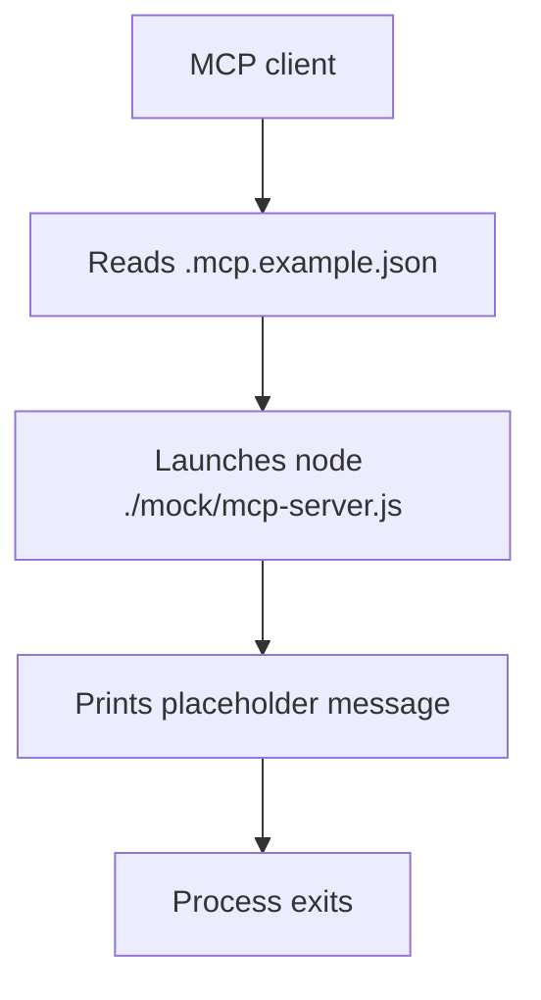

<!-- PAGE_ID: acquaman-plugin_04_mcp-configuration -->
<details>
<summary>📚 Relevant source files</summary>

The following files were used as context for generating this wiki page:

- [.mcp.json:1-29](https://github.com/port-gh-app-dev/acquaman-plugin/blob/7b88b3f075d9942173848e604a87dcbfbc62ba57/.mcp.json#L1-L29)
- [.mcp.example.json:1-16](https://github.com/port-gh-app-dev/acquaman-plugin/blob/7b88b3f075d9942173848e604a87dcbfbc62ba57/.mcp.example.json#L1-L16)
- [mcp-server.js:1-5](https://github.com/port-gh-app-dev/acquaman-plugin/blob/7b88b3f075d9942173848e604a87dcbfbc62ba57/mock/mcp-server.js#L1-L5)

</details>

# MCP Configuration and Mock Server

> **Related Pages**: [[Overview|01_overview.md]], [[CI and Known Issues|05_ci-and-known-issues.md]]

---

<!-- BEGIN:AUTOGEN acquaman-plugin_04_mcp-configuration_active-config -->
## Active Configuration (.mcp.json)

`.mcp.json` defines three servers under `mcpServers` ([.mcp.json:1-28](https://github.com/port-gh-app-dev/acquaman-plugin/blob/7b88b3f075d9942173848e604a87dcbfbc62ba57/.mcp.json#L1-L28)).

| Server | Transport | Target | Notes |
|--------|-----------|--------|-------|
| `acquaman-plugin-mock` | stdio (command) | `npx -y @modelcontextprotocol/server-everything` ([.mcp.json:2-7](https://github.com/port-gh-app-dev/acquaman-plugin/blob/7b88b3f075d9942173848e604a87dcbfbc62ba57/.mcp.json#L2-L7)) | Sets `NODE_ENV=development` ([.mcp.json:8-10](https://github.com/port-gh-app-dev/acquaman-plugin/blob/7b88b3f075d9942173848e604a87dcbfbc62ba57/.mcp.json#L8-L10)) |
| `remote-weather-service` | `http` | `https://mcp.accuweather.com` ([.mcp.json:13-15](https://github.com/port-gh-app-dev/acquaman-plugin/blob/7b88b3f075d9942173848e604a87dcbfbc62ba57/.mcp.json#L13-L15)) | An `env` entry holds a note about HTTP servers needing a direct endpoint URL ([.mcp.json:16-18](https://github.com/port-gh-app-dev/acquaman-plugin/blob/7b88b3f075d9942173848e604a87dcbfbc62ba57/.mcp.json#L16-L18)) |
| `secure-internal-db` | `http` | `http://10.0.1` ([.mcp.json:20-22](https://github.com/port-gh-app-dev/acquaman-plugin/blob/7b88b3f075d9942173848e604a87dcbfbc62ba57/.mcp.json#L20-L22)) | Sends `Authorization` and `X-Custom-Client-ID` headers ([.mcp.json:23-26](https://github.com/port-gh-app-dev/acquaman-plugin/blob/7b88b3f075d9942173848e604a87dcbfbc62ba57/.mcp.json#L23-L26)) |

The README describes `.mcp.json` as a "local default MCP server configuration using a mock server package" ([README.md:9](https://github.com/port-gh-app-dev/acquaman-plugin/blob/7b88b3f075d9942173848e604a87dcbfbc62ba57/README.md#L9)). That matches only the first entry; the other two point to remote HTTP endpoints. The `http://10.0.1` URL is an incomplete IPv4 address (three octets), so it is unlikely to resolve as written.

Sources: [.mcp.json:1-29](https://github.com/port-gh-app-dev/acquaman-plugin/blob/7b88b3f075d9942173848e604a87dcbfbc62ba57/.mcp.json#L1-L29)
<!-- END:AUTOGEN acquaman-plugin_04_mcp-configuration_active-config -->

---

<!-- BEGIN:AUTOGEN acquaman-plugin_04_mcp-configuration_example-config -->
## Example Configuration (.mcp.example.json)

`.mcp.example.json` shows one server per transport ([.mcp.example.json:2-15](https://github.com/port-gh-app-dev/acquaman-plugin/blob/7b88b3f075d9942173848e604a87dcbfbc62ba57/.mcp.example.json#L2-L15)):

| Server | Transport | Details |
|--------|-----------|---------|
| `acquaman-plugin-http` | HTTP | `url` is `http://localhost:3333/mcp`; an `Authorization` header holds the masked placeholder `******` ([.mcp.example.json:3-8](https://github.com/port-gh-app-dev/acquaman-plugin/blob/7b88b3f075d9942173848e604a87dcbfbc62ba57/.mcp.example.json#L3-L8)) |
| `acquaman-plugin-stdio` | stdio | Runs `node ./mock/mcp-server.js` ([.mcp.example.json:9-14](https://github.com/port-gh-app-dev/acquaman-plugin/blob/7b88b3f075d9942173848e604a87dcbfbc62ba57/.mcp.example.json#L9-L14)) |

The README instructs users to replace the placeholder values and copy this file to `.mcp.json` as needed ([README.md:17](https://github.com/port-gh-app-dev/acquaman-plugin/blob/7b88b3f075d9942173848e604a87dcbfbc62ba57/README.md#L17)). The `/mcp` path on port 3333 is not declared in `openapi.yaml`, and no server in the repository listens there.

Sources: [.mcp.example.json:1-16](https://github.com/port-gh-app-dev/acquaman-plugin/blob/7b88b3f075d9942173848e604a87dcbfbc62ba57/.mcp.example.json#L1-L16), [README.md:17](https://github.com/port-gh-app-dev/acquaman-plugin/blob/7b88b3f075d9942173848e604a87dcbfbc62ba57/README.md#L17)
<!-- END:AUTOGEN acquaman-plugin_04_mcp-configuration_example-config -->

---

<!-- BEGIN:AUTOGEN acquaman-plugin_04_mcp-configuration_mock-server -->
## Placeholder Mock Server

`mock/mcp-server.js` is a Node script with a shebang line ([mcp-server.js:1](https://github.com/port-gh-app-dev/acquaman-plugin/blob/7b88b3f075d9942173848e604a87dcbfbc62ba57/mock/mcp-server.js#L1)). Its comments state it is a placeholder to be replaced with a real MCP server implementation ([mcp-server.js:3-4](https://github.com/port-gh-app-dev/acquaman-plugin/blob/7b88b3f075d9942173848e604a87dcbfbc62ba57/mock/mcp-server.js#L3-L4)). Its only statement logs a message to standard output and exits ([mcp-server.js:5](https://github.com/port-gh-app-dev/acquaman-plugin/blob/7b88b3f075d9942173848e604a87dcbfbc62ba57/mock/mcp-server.js#L5)).

```javascript
console.log('Mock MCP server placeholder. Replace with real server implementation.');
```

The script does not speak the MCP protocol: it reads no input and sends no JSON-RPC messages. An MCP client that launches it through the `acquaman-plugin-stdio` entry would therefore not get a working server until the script is replaced.



Sources: [mcp-server.js:1-5](https://github.com/port-gh-app-dev/acquaman-plugin/blob/7b88b3f075d9942173848e604a87dcbfbc62ba57/mock/mcp-server.js#L1-L5), [.mcp.example.json:9-14](https://github.com/port-gh-app-dev/acquaman-plugin/blob/7b88b3f075d9942173848e604a87dcbfbc62ba57/.mcp.example.json#L9-L14)
<!-- END:AUTOGEN acquaman-plugin_04_mcp-configuration_mock-server -->

---

<!-- BEGIN:AUTOGEN acquaman-plugin_04_mcp-configuration_security -->
## Security Considerations

- **Credential-like value committed in `.mcp.json`.** The `secure-internal-db` entry contains an `Authorization` header with a `Bearer` token value ([.mcp.json:23-24](https://github.com/port-gh-app-dev/acquaman-plugin/blob/7b88b3f075d9942173848e604a87dcbfbc62ba57/.mcp.json#L23-L24)). The value is intentionally not reproduced in this wiki. If it is a real credential, it should be revoked and rotated, and the file should read secrets from the environment or an untracked file instead.
- **Placeholder in the example.** `.mcp.example.json` uses a masked `******` value, which is the safer pattern for committed files ([.mcp.example.json:5-7](https://github.com/port-gh-app-dev/acquaman-plugin/blob/7b88b3f075d9942173848e604a87dcbfbc62ba57/.mcp.example.json#L5-L7)).
- **Unpinned package execution.** `acquaman-plugin-mock` runs `npx -y` on `@modelcontextprotocol/server-everything` with no version pin, so whichever version is current is downloaded and executed ([.mcp.json:3-7](https://github.com/port-gh-app-dev/acquaman-plugin/blob/7b88b3f075d9942173848e604a87dcbfbc62ba57/.mcp.json#L3-L7)).
- **Plain HTTP.** `secure-internal-db` uses `http://`, so headers would be sent unencrypted ([.mcp.json:21-26](https://github.com/port-gh-app-dev/acquaman-plugin/blob/7b88b3f075d9942173848e604a87dcbfbc62ba57/.mcp.json#L21-L26)).

Sources: [.mcp.json:1-29](https://github.com/port-gh-app-dev/acquaman-plugin/blob/7b88b3f075d9942173848e604a87dcbfbc62ba57/.mcp.json#L1-L29), [.mcp.example.json:1-16](https://github.com/port-gh-app-dev/acquaman-plugin/blob/7b88b3f075d9942173848e604a87dcbfbc62ba57/.mcp.example.json#L1-L16)
<!-- END:AUTOGEN acquaman-plugin_04_mcp-configuration_security -->

---
