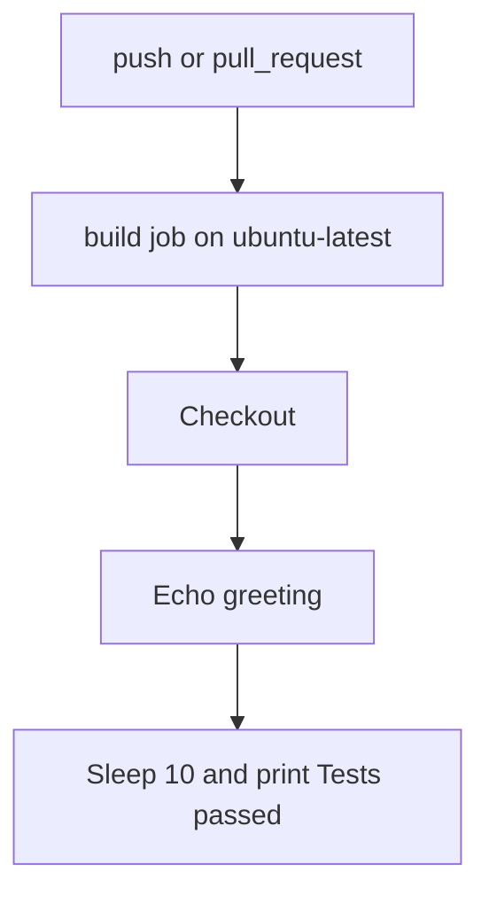

<!-- PAGE_ID: acquaman-plugin_05_ci-and-known-issues -->

📚 Relevant source files

The following files were used as context for generating this wiki page:

- [ci_workflow_1_xz25.yml:1-13](https://github.com/port-gh-app-dev/acquaman-plugin/blob/7b88b3f075d9942173848e604a87dcbfbc62ba57/.github/workflows/ci_workflow_1_xz25.yml#L1-L13)
- [ci_workflow_2_pnwt.yml:1-13](https://github.com/port-gh-app-dev/acquaman-plugin/blob/7b88b3f075d9942173848e604a87dcbfbc62ba57/.github/workflows/ci_workflow_2_pnwt.yml#L1-L13)
- [plugin.json:1-18](https://github.com/port-gh-app-dev/acquaman-plugin/blob/7b88b3f075d9942173848e604a87dcbfbc62ba57/.codex-plugin/plugin.json#L1-L18)
- [.mcp.json:1-29](https://github.com/port-gh-app-dev/acquaman-plugin/blob/7b88b3f075d9942173848e604a87dcbfbc62ba57/.mcp.json#L1-L29)
- [.mcp.example.json:1-16](https://github.com/port-gh-app-dev/acquaman-plugin/blob/7b88b3f075d9942173848e604a87dcbfbc62ba57/.mcp.example.json#L1-L16)
- [README.md:1-23](https://github.com/port-gh-app-dev/acquaman-plugin/blob/7b88b3f075d9942173848e604a87dcbfbc62ba57/README.md#L1-L23)

# CI and Known Issues

> **Related Pages**: [[MCP Configuration and Mock Server|04_mcp-configuration.md]], [[Plugin Manifests|02_plugin-manifests.md]]

---

<!-- BEGIN:AUTOGEN acquaman-plugin_05_ci-and-known-issues_workflows -->
## CI Workflows

Two GitHub Actions workflows exist: `ci_workflow_1_xz25` and `ci_workflow_2_pnwt` ([ci_workflow_1_xz25.yml:2](https://github.com/port-gh-app-dev/acquaman-plugin/blob/7b88b3f075d9942173848e604a87dcbfbc62ba57/.github/workflows/ci_workflow_1_xz25.yml#L2), [ci_workflow_2_pnwt.yml:2](https://github.com/port-gh-app-dev/acquaman-plugin/blob/7b88b3f075d9942173848e604a87dcbfbc62ba57/.github/workflows/ci_workflow_2_pnwt.yml#L2)). They are identical apart from their names and the name echoed in their greeting. Both trigger on every `push` and `pull_request` ([ci_workflow_1_xz25.yml:3](https://github.com/port-gh-app-dev/acquaman-plugin/blob/7b88b3f075d9942173848e604a87dcbfbc62ba57/.github/workflows/ci_workflow_1_xz25.yml#L3)) and run a single `build` job on `ubuntu-latest` ([ci_workflow_1_xz25.yml:5-7](https://github.com/port-gh-app-dev/acquaman-plugin/blob/7b88b3f075d9942173848e604a87dcbfbc62ba57/.github/workflows/ci_workflow_1_xz25.yml#L5-L7)).

| Step | Action | Effect |
|------|--------|--------|
| 1 | `actions/checkout@v4` | Checks out the repository ([ci_workflow_1_xz25.yml:9](https://github.com/port-gh-app-dev/acquaman-plugin/blob/7b88b3f075d9942173848e604a87dcbfbc62ba57/.github/workflows/ci_workflow_1_xz25.yml#L9)) |
| 2 | Run a one-line script | Echoes a greeting that includes the repository name ([ci_workflow_1_xz25.yml:10-11](https://github.com/port-gh-app-dev/acquaman-plugin/blob/7b88b3f075d9942173848e604a87dcbfbc62ba57/.github/workflows/ci_workflow_1_xz25.yml#L10-L11)) |
| 3 | Simulate tests | `sleep 10` then prints "Tests passed!" ([ci_workflow_1_xz25.yml:12-13](https://github.com/port-gh-app-dev/acquaman-plugin/blob/7b88b3f075d9942173848e604a87dcbfbc62ba57/.github/workflows/ci_workflow_1_xz25.yml#L12-L13)) |

The "tests" are simulated: the workflows run no linters, JSON validators, or real tests, so they would not catch the problems listed below.

Sources: [ci_workflow_1_xz25.yml:1-13](https://github.com/port-gh-app-dev/acquaman-plugin/blob/7b88b3f075d9942173848e604a87dcbfbc62ba57/.github/workflows/ci_workflow_1_xz25.yml#L1-L13), [ci_workflow_2_pnwt.yml:1-13](https://github.com/port-gh-app-dev/acquaman-plugin/blob/7b88b3f075d9942173848e604a87dcbfbc62ba57/.github/workflows/ci_workflow_2_pnwt.yml#L1-L13)
<!-- END:AUTOGEN acquaman-plugin_05_ci-and-known-issues_workflows -->

---

<!-- BEGIN:AUTOGEN acquaman-plugin_05_ci-and-known-issues_known-issues -->
## Known Issues and Production Checklist

The following observations come directly from the committed files.

| # | Issue | Evidence |
|---|-------|----------|
| 1 | `.codex-plugin/plugin.json` is invalid JSON (missing comma after `skills`) | ([plugin.json:6-7](https://github.com/port-gh-app-dev/acquaman-plugin/blob/7b88b3f075d9942173848e604a87dcbfbc62ba57/.codex-plugin/plugin.json#L6-L7)) |
| 2 | `skills` points to `./skills/`, which does not exist in the repository | ([plugin.json:6](https://github.com/port-gh-app-dev/acquaman-plugin/blob/7b88b3f075d9942173848e604a87dcbfbc62ba57/.codex-plugin/plugin.json#L6)) |
| 3 | A bearer token is committed in `.mcp.json` (value not reproduced here) | ([.mcp.json:23-24](https://github.com/port-gh-app-dev/acquaman-plugin/blob/7b88b3f075d9942173848e604a87dcbfbc62ba57/.mcp.json#L23-L24)) |
| 4 | `secure-internal-db` URL `http://10.0.1` is an incomplete IPv4 address | ([.mcp.json:21-22](https://github.com/port-gh-app-dev/acquaman-plugin/blob/7b88b3f075d9942173848e604a87dcbfbc62ba57/.mcp.json#L21-L22)) |
| 5 | The mock stdio server only prints a message and does not implement MCP | ([mcp-server.js:3-5](https://github.com/port-gh-app-dev/acquaman-plugin/blob/7b88b3f075d9942173848e604a87dcbfbc62ba57/mock/mcp-server.js#L3-L5)) |
| 6 | `logo.png`, `/legal`, and `/mcp` on port 3333 are referenced but not defined in `openapi.yaml` and not served by anything in the repository | ([ai-plugin.json:15-17](https://github.com/port-gh-app-dev/acquaman-plugin/blob/7b88b3f075d9942173848e604a87dcbfbc62ba57/.well-known/ai-plugin.json#L15-L17), [.mcp.example.json:4](https://github.com/port-gh-app-dev/acquaman-plugin/blob/7b88b3f075d9942173848e604a87dcbfbc62ba57/.mcp.example.json#L4), [openapi.yaml:8-43](https://github.com/port-gh-app-dev/acquaman-plugin/blob/7b88b3f075d9942173848e604a87dcbfbc62ba57/openapi.yaml#L8-L43)) |
| 7 | The README omits `.codex-plugin/plugin.json` and the CI workflows from its file list | ([README.md:5-11](https://github.com/port-gh-app-dev/acquaman-plugin/blob/7b88b3f075d9942173848e604a87dcbfbc62ba57/README.md#L5-L11)) |
| 8 | The two CI workflows duplicate each other and only simulate tests | ([ci_workflow_1_xz25.yml:12-13](https://github.com/port-gh-app-dev/acquaman-plugin/blob/7b88b3f075d9942173848e604a87dcbfbc62ba57/.github/workflows/ci_workflow_1_xz25.yml#L12-L13), [ci_workflow_2_pnwt.yml:12-13](https://github.com/port-gh-app-dev/acquaman-plugin/blob/7b88b3f075d9942173848e604a87dcbfbc62ba57/.github/workflows/ci_workflow_2_pnwt.yml#L12-L13)) |

Before production use, the README itself calls for updating the contact email, legal URL, API URLs, and auth settings ([README.md:23](https://github.com/port-gh-app-dev/acquaman-plugin/blob/7b88b3f075d9942173848e604a87dcbfbc62ba57/README.md#L23)). The `contact_email` is currently `support@example.com` ([ai-plugin.json:16](https://github.com/port-gh-app-dev/acquaman-plugin/blob/7b88b3f075d9942173848e604a87dcbfbc62ba57/.well-known/ai-plugin.json#L16)).

Sources: [README.md:20-23](https://github.com/port-gh-app-dev/acquaman-plugin/blob/7b88b3f075d9942173848e604a87dcbfbc62ba57/README.md#L20-L23), [plugin.json:1-18](https://github.com/port-gh-app-dev/acquaman-plugin/blob/7b88b3f075d9942173848e604a87dcbfbc62ba57/.codex-plugin/plugin.json#L1-L18), [.mcp.json:1-29](https://github.com/port-gh-app-dev/acquaman-plugin/blob/7b88b3f075d9942173848e604a87dcbfbc62ba57/.mcp.json#L1-L29), [.mcp.example.json:1-16](https://github.com/port-gh-app-dev/acquaman-plugin/blob/7b88b3f075d9942173848e604a87dcbfbc62ba57/.mcp.example.json#L1-L16)
<!-- END:AUTOGEN acquaman-plugin_05_ci-and-known-issues_known-issues -->

---
